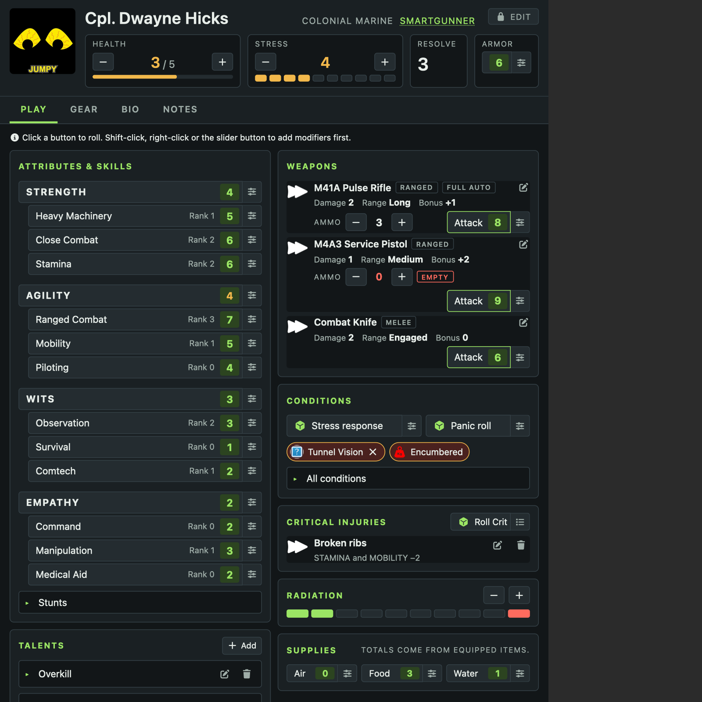
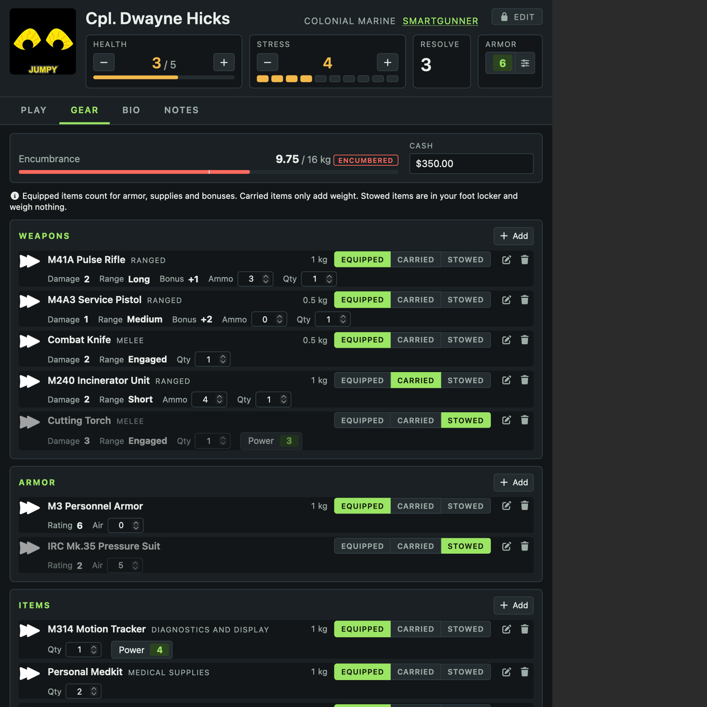

# Alien RPG Alternate Sheet

An alternate character sheet for the [Alien RPG system](https://github.com/pwatson100/alienrpg)
(`alienrpg` 4.x, Foundry v13–v14), built for the **Evolved** rules. It registers alongside the
system's sheet for `character`, `synthetic`, `creature`, `vehicles`, `spacecraft`, `territory`, `colony` and `planet` actors, so either can be used per actor.

<p>
  
  
</p>

- **Play tab** — attributes and skills, equipped weapons, conditions, critical injuries, radiation
  and supplies on one screen. Every roll is a button showing the number of dice it rolls. The
  slider button beside it (or shift-click, or right-click) asks for modifiers first.
- **Gear tab** — weapons, armor and items with an Equipped / Carried / Stowed switch on each row,
  ammo and quantities edited in place, and an encumbrance bar.
- **Bio tab** — appearance, agenda, buddy and rival, experience, story points and agenda cards.
- **Rules tab** — a quick reference; for now the full and quick actions you can take in a round.
- **Edit lock** — attributes, skill ranks, name, career and portrait only change when the Edit
  button in the header is on. A blank character opens unlocked.
- **Creature sheet** — health, speed and armor in the header; the signature attack with a list of
  what each roll on its table does; mobility, observation and acid splash as roll buttons; special
  abilities and critical injuries. Stats and tables are behind the same Edit lock.
- **Vehicle sheet** — hull, armor, speed and manoeuvrability in the header; the crew with a seat
  picker, the pilot's Piloting roll (manoeuvrability included) and each member's stress response;
  mounted weapons with ammo and an Attack button; and a Cargo tab for everything aboard.
- **Spacecraft sheet** — damage against hull, armor, thrusters and signature in the header; the crew
  with each station's roll (Piloting with thrusters, Comtech, Heavy Machinery); armaments with Fire
  and Launch buttons; minor and major component damage; a Combat tab that announces each phase's
  action; and a Cargo tab with the ship's modules.
- **Territory sheet** — a territory's systems grouped by sector, each opening its own sheet, and
  an About tab for its description and sectors.
- **Colony sheet** — the six stats with who heads each and what the colony's initiatives add, the
  development total and level, the colony's details, and its policies, installations and projects.
- **Planet sheet** — the star system, the world, and its surface region by region with each
  region's resource potential.
- **Gear sheets** — one sheet for weapons, armor and items: the fields that apply to that kind of
  gear on a Details tab with its description, a Notes tab, and a Modifiers tab for the bonuses it
  gives whoever has it equipped. A computer's own dice are roll buttons.
- **Career and system sheets** — the same item sheet for Career/Specialty items (the description
  on its own) and Planet/System items (the system's details as labelled fields, then its
  description).
- **Other item sheets** — the same item sheet again, each under its own name, for talents, ship
  modules, ship weapons, skill stunts, agendas, critical injuries, ship component damage and colony
  initiatives.
- **Journal sheet** — Foundry's journal sheet in the same look: the sidebar, title, headings and
  links are restyled, and what a page's own layout sets is left alone.

The sheet subclasses the system's own sheet class and calls the system's roll methods, so dice,
pushes, panic and supply rolls behave exactly as they do on the original sheet.

## Installing

In Foundry's Setup → **Add-on Modules** → **Install Module**, paste this manifest URL:

```
https://github.com/tmilktoast/alienrpg-alt-sheet/releases/latest/download/module.json
```

## Using it

Open a character, creature or vehicle, click the ⋮ menu in the window header → **Configure Sheet**, and pick
the one named for it — **Alternate Character Sheet**, **Alternate Creature Sheet** and so on. To make it the default for every character, set it under *Default Sheet* in the
same dialog (GM only). Each actor type has its own default. Weapons, armor and items work the same way from an item's
own ⋮ menu, and journals from a journal's.

## Local development

Symlink this folder into a Foundry data directory that has the `alienrpg` system installed, then
enable the module in an Alien RPG world:

```sh
ln -s "$PWD" "<foundry data>/Data/modules/alienrpg-alt-sheet"
```

Changes to `module.json` need a return to Setup; everything else only needs F5.

## How it hooks in

`scripts/alt-sheet.mjs` waits for `ready`, looks up the system's registered sheet class for each
actor type in `CONFIG.Actor.sheetClasses`, and registers a subclass of it. What it relies on from the
system:

- the sheet's `_prepareContext` (items, encumbrance, `statuses`, `talents`, `agendas`, `critInj`,
  `specialities`), its `toggleStatus` action and its static `_onRadPointClick`
- actor methods `abilityRoll`, `rollStress`, `rollResolve`, `rollCrit`, `consumablesCheck` and their
  `…Mod` / `rollCritMan` variants, and `item.roll`
- for creatures, the sheet's `rTables` / `cTables` lists and `critInj`, and actor methods
  `creatureAutoAttackRoll`, `creatureManAttackRoll` and `creatureAcidRoll`
- for vehicles, the sheet's actor drop handling (which seats a dropped character), actor methods
  `addVehicleOccupant` and `removeVehicleOccupant`, and `CONFIG.ALIENRPG.vehicle` for the seats
- for gear, the item sheet's `RollComputer` action and the numbered types in
  `CONFIG.ALIENRPG.item_types_list`, which decide the fields an item shows

The journal sheet is Foundry's own `JournalEntrySheet` with an extra class. The system has no
journal sheet, only CSS for Foundry's, which the module's stylesheet overrides under that class.

If a system update renames any of those, that is where to look.
